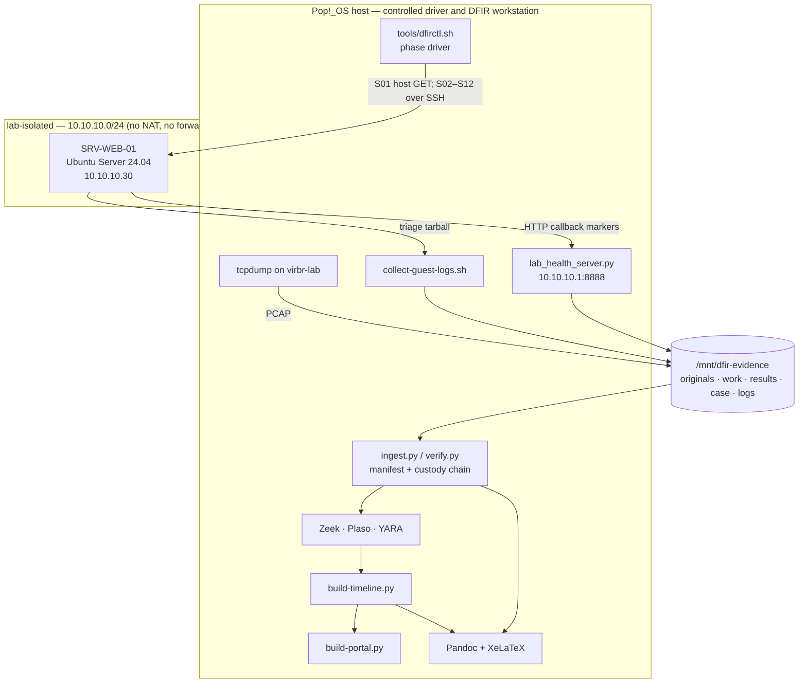
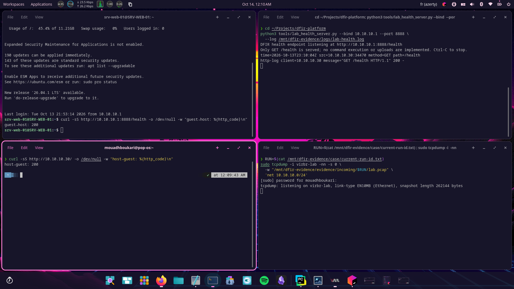
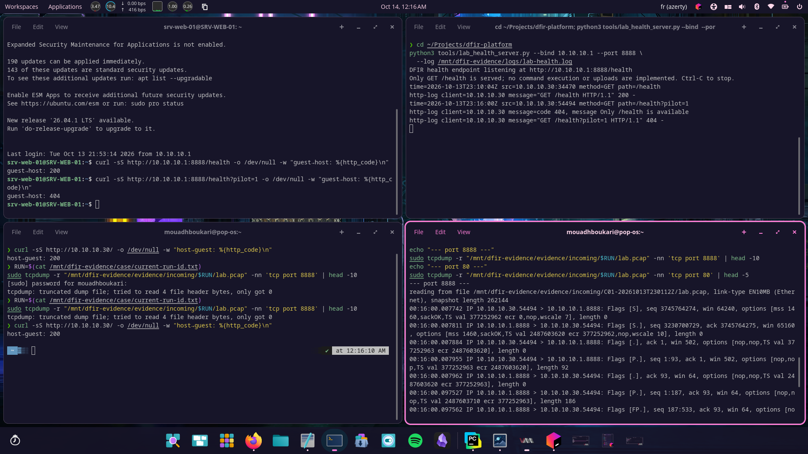
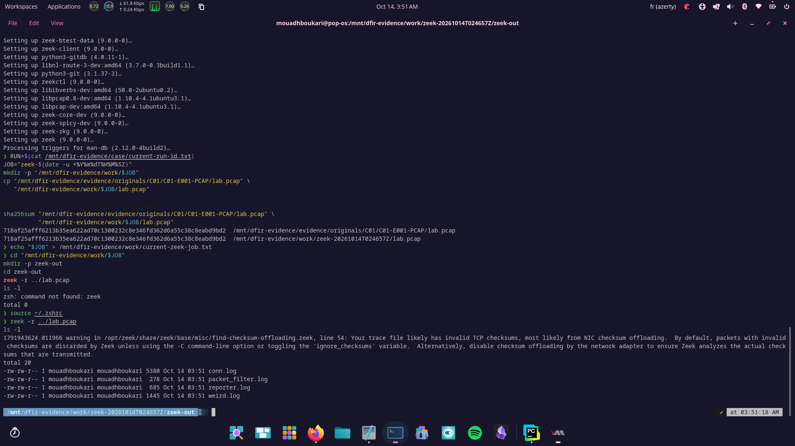
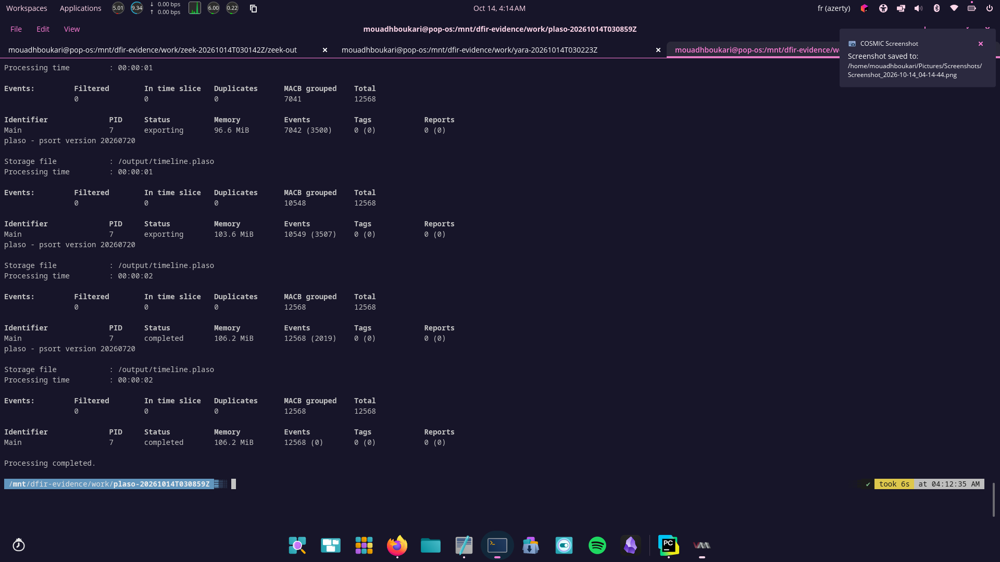

# DFIR Lab Platform

**A self-hosted, reproducible Linux web-server compromise emulation and end-to-end DFIR pipeline.**

This project runs a scripted intrusion against a single Ubuntu Server guest on an isolated libvirt network, captures the resulting evidence, preserves it with a cryptographic chain of custody, processes it into a unified timeline, and publishes the case through a static investigation portal and a PDF-ready report.

Everything is synthetic and lab-only: no live malware, no real credentials, no external command-and-control, and no data leaves the lab.

---

## Contents

- [What This Project Does](#what-this-project-does)
- [Scope and Safety](#scope-and-safety)
- [Architecture](#architecture)
- [Repository Layout](#repository-layout)
- [Current Implementation Status](#current-implementation-status)
- [Prerequisites](#prerequisites)
- [Quick Start](#quick-start)
- [Orchestrator Commands](#orchestrator-commands)
- [Evidence Lifecycle and Integrity](#evidence-lifecycle-and-integrity)
- [Scenario Coverage](#scenario-coverage)
- [Analysis Pipeline and Outputs](#analysis-pipeline-and-outputs)
- [Case Portal](#case-portal)
- [Optional Timesketch UI](#optional-timesketch-ui)
- [Incident Report](#incident-report)
- [Screenshots](#screenshots)
- [Known Limitations and Troubleshooting](#known-limitations-and-troubleshooting)
- [Documentation](#documentation)

---

## What This Project Does

The platform implements a complete forensic workflow around case **C01**:

1. **Emulate** a Linux web-server compromise with twelve ATT&CK-mapped steps.
2. **Capture** network traffic on the lab bridge and collect guest logs.
3. **Ingest** evidence into an immutable store with SHA-256, MD5, and a hash-chained custody log.
4. **Verify** every original file before analysis and again before publication.
5. **Process** evidence with Zeek (network), Plaso (super-timeline), and YARA (marker detection).
6. **Merge** network, host, and health-endpoint events into one UTC timeline.
7. **Publish** a searchable static case portal and a PDF incident report.

| Item | Value |
|---|---|
| Case | `C01` — Linux web-server compromise emulation |
| Victim | `SRV-WEB-01`, Ubuntu Server 24.04, `10.10.10.30` |
| Lab network | `lab-isolated`, `10.10.10.0/24`, no NAT, no forwarding |
| Host bridge | `virbr-lab`, `10.10.10.1` |
| Evidence root | `/mnt/dfir-evidence` |
| Acquisition | Host-side `tcpdump` + guest triage bundle |
| Analysis | Zeek, Plaso, YARA, merged CSV timeline |
| Deliverables | Static HTML portal, Markdown/PDF report |

---

## Scope and Safety

This is an **emulation**, not a live attack. Read the scenario definition in [`scenarios/linux-web-server-compromise.yaml`](scenarios/linux-web-server-compromise.yaml) before running anything.

- **One Linux guest only.** Windows, Sysmon, WinPmem, registry/MFT analysis, and Windows-to-Linux lateral movement are out of scope. See [`docs/DECISIONS.md`](docs/DECISIONS.md) and [`IMPLEMENTATION_GUIDE.md`](IMPLEMENTATION_GUIDE.md).
- **No real exploitation.** Initial access, exfiltration, and defense-evasion steps are markers only.
- **No real secrets.** Canary files and a dummy key-shaped file are used instead of credentials or private keys.
- **No real exfiltration.** Staging stays inside the guest; no file is uploaded outside the lab.
- **No real log clearing.** The defense-evasion step records a marker only.
- **No Internet path.** `lab-isolated` has no `<forward>` element and no default route in the guest.
- **Indicators are lab-only.** Values shown in the portal are generated by this lab and are **not threat intelligence**.

---

## Architecture



**Operating model.** The victim is powered on only while the scenario runs and evidence is acquired. It is then shut down, and analysis runs on the host against working copies. This keeps memory usage within a 16 GB workstation and matches forensic practice.

**Trust boundaries.** The host drives the scenario, serves the health endpoint, captures traffic, and stores evidence. The guest can reach only the host bridge on the lab subnet. All web interfaces are bound to `127.0.0.1`.

---

## Repository Layout

```text
dfir-platform/
├── ansible/                         # Provisioning placeholder (not yet implemented)
├── compose/
│   └── timesketch/                  # Optional Timesketch + OpenSearch stack
├── dfirctl/                         # Legacy ingestion wrappers (pre-consolidation)
├── docs/
│   ├── architecture.md              # Design specification and requirements
│   ├── commands.md                  # Commands used in the actual run
│   ├── DECISIONS.md                 # Scope and implementation decisions
│   ├── PLAN.md                      # Host baseline and delivery plan
│   ├── runbook.md                   # Ingestion and recovery procedures
│   └── version.md                   # Tool/version pin register
├── libvirt/
│   └── lab-isolated.xml             # Isolated libvirt network (no <forward>)
├── portal/templates/                # Jinja2 case-portal template and CSS
├── report/                          # Incident report source
├── rules/                           # YARA rules for lab markers and beacon artifacts
├── scenarios/
│   ├── linux-web-server-compromise.yaml   # S01–S12 scenario definition
│   └── beacon.py                    # Legacy standalone beacon stand-in
├── screenshots/                     # Evidence from the completed lab run
├── templates/report.md              # Pandoc report template
├── tests/
│   └── smoke-test-evidence.sh       # Ingest + tamper-detection smoke test
├── tools/
│   ├── dfirctl.sh                   # Main phase driver / orchestrator
│   ├── ingest.py                    # Evidence registration + custody chain
│   ├── verify.py                    # Original hashes + custody-chain verification
│   ├── collect-guest-logs.sh        # Guest triage collection wrapper
│   ├── gt-append.sh                 # Append validated ground-truth step records
│   ├── lab_health_server.py         # Local-only GET /health endpoint
│   ├── build-timeline.py            # Merge Zeek, Plaso, and health logs
│   ├── compare-gt.py                # Compare timeline evidence to ground truth
│   └── build-portal.py              # Render static HTML case portal
└── IMPLEMENTATION_GUIDE.md          # Full host/guest build procedure
```

> **Legacy note:** `dfirctl/ingest.sh` and `dfirctl/verify.sh` predate the consolidated tools and expect a removed `custody.py`. Use `tools/ingest.py` and `tools/verify.py` instead. The decision is recorded in [`docs/DECISIONS.md`](docs/DECISIONS.md).

---

## Current Implementation Status

| Area | Status |
|---|---|
| Isolated libvirt network | Implemented |
| Linux victim scenario (S01–S12) | Implemented |
| Host-side PCAP capture | Implemented |
| Guest log/triage collection | Implemented |
| Evidence ingest, manifest, custody chain | Implemented |
| Hash verification and tamper test | Implemented |
| Ground-truth recording and sealing | Implemented |
| Zeek, Plaso, YARA processing | Implemented |
| Unified timeline and coverage comparison | Implemented |
| Static case portal | Implemented |
| Pandoc report generation | Implemented |
| Timesketch Compose stack | Provided as optional |
| Ansible provisioning | Placeholder only |
| Velociraptor, DFIR-IRIS, Volatility | Deferred / not part of current pipeline |

---

## Prerequisites

### Host

- Pop!_OS / Ubuntu Linux with KVM and libvirt (`qemu:///system` reachable)
- 16 GB RAM recommended; a dedicated evidence filesystem with roughly 250 GB
- Docker Engine and Docker Compose v2
- Python 3.11+
- `tcpdump`, `jq`, `zeek`, `yara`, `pandoc`, and a XeLaTeX engine
- `chattr` from `e2fsprogs` if you intend to use `--immutable`

```bash
sudo apt update
sudo apt install -y qemu-kvm libvirt-daemon-system libvirt-clients virt-manager \
  docker.io docker-compose-v2 python3 python3-venv python3-pip \
  tcpdump tshark jq yara pandoc texlive-xetex
sudo usermod -aG libvirt,kvm,docker "$USER"
```

Log out and back in after changing group membership. Membership in `docker` is effectively root-equivalent; keep host access restricted.

### Evidence filesystem

The scripts assume `/mnt/dfir-evidence`:

```bash
sudo mkdir -p /mnt/dfir-evidence/{evidence/incoming,evidence/originals,work,results,case,logs,backups}
sudo chown -R "$USER":"$USER" /mnt/dfir-evidence
findmnt /mnt/dfir-evidence
df -h /mnt/dfir-evidence
```

Use a dedicated ext4 partition or external SSD. Do not proceed until `findmnt` confirms the evidence filesystem is mounted; otherwise evidence can fill the root filesystem.

### Victim guest

`SRV-WEB-01` must exist in libvirt and be provisioned with:

- Ubuntu Server 24.04 at `10.10.10.30` on `lab-isolated`
- `nginx`, `OpenSSH`, `auditd`, and `journald`
- Synthetic lab data under `/opt/dfir-demo`
- A passwordless collector at `/usr/local/sbin/dfir-collect-logs`
- SSH key authentication from the host
- A clean snapshot (the orchestrator defaults to `snapshot3`)

The complete build procedure is in [`IMPLEMENTATION_GUIDE.md`](IMPLEMENTATION_GUIDE.md). The `ansible/` directory is a placeholder; provisioning is currently manual.

### Optional portal environment

`tools/dfirctl.sh portal` expects a virtual environment at `~/venvs/portal`:

```bash
python3 -m venv ~/venvs/portal
~/venvs/portal/bin/pip install jinja2
```

---

## Quick Start

All commands run from the repository root.

### 1. Define and start the isolated network

```bash
sudo virsh net-define libvirt/lab-isolated.xml
sudo virsh net-start lab-isolated
sudo virsh net-autostart lab-isolated
virsh net-list --all
```

### 2. Run preflight checks

```bash
./tools/dfirctl.sh preflight
```

This verifies that the network is active, the expected snapshot exists, required host tools are installed, the guest has no default route, auditd rules are present, and the guest collector works.

### 3. Execute the full pipeline

```bash
./tools/dfirctl.sh all
```

`all` runs:

```text
preflight → scenario → collect → ingest → verify → process → timeline → verify → portal
```

The scenario creates a run ID, starts the health endpoint and `tcpdump`, executes S01 from the host and S02–S12 over SSH, seals the ground-truth file, collects guest logs, powers off the victim, ingests evidence, runs Zeek/Plaso/YARA, builds the merged timeline, re-verifies evidence, and renders the portal.

### 4. Generate the PDF report

```bash
./tools/dfirctl.sh report
```

The output is written to `report/C01-report.pdf`.

### Run steps individually

```bash
./tools/dfirctl.sh preflight
./tools/dfirctl.sh run
./tools/dfirctl.sh collect
./tools/dfirctl.sh ingest
./tools/dfirctl.sh verify
./tools/dfirctl.sh process
./tools/dfirctl.sh timeline
./tools/dfirctl.sh portal
./tools/dfirctl.sh report
```

`CASE`, `SNAP`, and `VM` can be overridden as environment variables. The evidence root and guest address are configured at the top of [`tools/dfirctl.sh`](tools/dfirctl.sh).

---

## Orchestrator Commands

| Command | Purpose | Main outputs |
|---|---|---|
| `preflight` | Validate host, network, snapshot, guest isolation, auditd, and collector | Pass/fail messages |
| `run` | Execute S01–S12, capture PCAP, record and seal ground truth | `evidence/incoming/<run>/lab.pcap`, `case/ground-truth-sealed.jsonl` |
| `collect` | Pull guest triage logs and shut down the victim | `evidence/incoming/<run>/guest-logs/guest-logs.tar.gz` |
| `ingest` | Register PCAP and triage bundle as originals | `case/manifest.jsonl`, `case/custody.jsonl` |
| `verify` | Re-hash originals and validate the custody chain | PASS/FAIL output; non-zero exit on failure |
| `process` | Run Zeek on PCAP and Plaso + YARA on triage | `results/*/zeek`, `results/*/plaso`, `results/*/yara` |
| `timeline` | Merge Zeek, Plaso, and health-endpoint events | `results/C01/timeline-merged.csv` |
| `portal` | Render the static case portal | `results/C01/portal/index.html` |
| `report` | Build the PDF incident report from Markdown | `report/C01-report.pdf` |
| `all` | Run the complete pipeline except report generation | All of the above |

Each run is logged to `/mnt/dfir-evidence/logs/dfirctl-<UTC timestamp>.log`.

---

## Evidence Lifecycle and Integrity

### Ingest

`tools/ingest.py` performs the following atomically as far as the underlying filesystem allows:

1. Restricts the source to `evidence/incoming/`.
2. Computes SHA-256, MD5, and size.
3. Moves the file to `evidence/originals/<case>/<evidence-id>/`.
4. Sets mode `0444`; optionally sets `chattr +i` with `--immutable`.
5. Re-hashes the destination and compares it with the source.
6. Appends a manifest record and two custody records (`registered`, `frozen`).

Evidence IDs follow `C01-E###-TYPE`, for example `C01-E001-PCAP` and `C01-E002-TRIAGE`.

```bash
python3 tools/ingest.py \
  --root /mnt/dfir-evidence \
  --case C01 \
  --type PCAP \
  --note "Host-side capture on virbr-lab" \
  /mnt/dfir-evidence/evidence/incoming/<run-id>/lab.pcap
```

Add `--immutable` only on a supported filesystem and after validating the pipeline. See [`docs/runbook.md`](docs/runbook.md) for recovery if an ingest partially fails.

### Custody chain

Every custody record includes the previous record's hash. Changing any past record breaks every subsequent `entry_hash`:

```json
{
  "timestamp_utc": "2026-10-14T09:21:07Z",
  "evidence_id": "C01-E001-PCAP",
  "action": "registered",
  "actor": "analyst",
  "host": "pop-os",
  "tool": "dfir-ingest/0.1.0",
  "sha256": "8f14e45fceea167a5a36dedd4bea2543...",
  "md5": "c9f0f895fb98ab9159f51fd0297e236d",
  "note": "Host-side bridge traffic capture",
  "prev_entry_hash": "",
  "entry_hash": "3b241101dda...e8b7"
}
```

### Verify

```bash
python3 tools/verify.py --root /mnt/dfir-evidence
```

The verifier re-hashes every original in `manifest.jsonl`, validates the chain in `custody.jsonl`, prints the chain tip, and exits non-zero on any mismatch.

### Tamper-detection smoke test

```bash
./tests/smoke-test-evidence.sh
```

This creates a disposable evidence root, ingests a canary file, verifies it, modifies the stored original, and confirms the verifier fails.

### Ground truth

`tools/gt-append.sh` refuses malformed timestamps and placeholder values before appending a step record. The orchestrator seals the file with SHA-256 and sets mode `0400` after all twelve steps complete. The digest is displayed in the portal so the scenario record can be anchored separately.

---

## Scenario Coverage

| Step | Behavior | ATT&CK | Execution status |
|---|---|---|---|
| S01 | Inbound request to the guest nginx landing page | T1190 | `emulated_marker_only` |
| S02 | Benign shell diagnostic writing a marker | T1059.004 | `executed_benign_behavior` |
| S03 | Finite HTTP callbacks to the host health endpoint | T1071.001 | `emulated_network_behavior` |
| S04 | System discovery (`uname`, `hostname`, `os-release`, `id`, `uptime`) | T1082 | `executed_benign_behavior` |
| S05 | Account discovery (`/etc/passwd`, `whoami`, `w`, `last`) | T1033, T1087.001 | `executed_benign_behavior` |
| S06 | Read of a synthetic credential canary | T1552.001 | `emulated_with_canary` |
| S07 | Read of a dummy key-shaped file | T1552.004 | `emulated_with_dummy_artifact` |
| S08 | Temporary cron entry, fired and removed | T1053.003 | `executed_with_cleanup` |
| S09 | Copy and archive of a synthetic database | T1560.001 | `executed_benign_behavior` |
| S10 | Move the archive to a staging directory | T1074.001 | `executed_benign_behavior` |
| S11 | Record an exfiltration marker; no transfer occurs | T1041 | `emulated_marker_only` |
| S12 | Record a defense-evasion marker; no logs are cleared | T1070.003 | `emulated_marker_only` |

`tools/compare-gt.py` matches timeline events against sealed ground-truth start times and reports coverage. The documented run matched 11 of 12 steps live; S02 was reconstructed from an auditd `EXECVE` record ([`docs/DECISIONS.md`](docs/DECISIONS.md)).

---

## Analysis Pipeline and Outputs

### Evidence store layout

```text
/mnt/dfir-evidence/
├── case/
│   ├── current-run-id.txt
│   ├── ground-truth-sealed.jsonl
│   ├── ground-truth-sealed.jsonl.sha256
│   ├── manifest.jsonl
│   └── custody.jsonl
├── evidence/
│   ├── incoming/<run-id>/
│   │   ├── lab.pcap
│   │   └── guest-logs/guest-logs.tar.gz
│   └── originals/C01/C01-E001-PCAP/lab.pcap
│       └── C01-E002-TRIAGE/guest-logs.tar.gz
├── work/<job-id>/                  # Disposable working copies
├── results/
│   ├── C01-E001-PCAP/zeek/         # conn.log, http.log, dns.log, ...
│   ├── C01-E002-TRIAGE/
│   │   ├── plaso/                  # timeline.plaso, timeline.jsonl
│   │   └── yara/matches.txt
│   └── C01/
│       ├── timeline-merged.csv
│       └── portal/index.html
└── logs/
    ├── dfirctl-*.log
    └── lab-health.log
```

### Processing details

- **Zeek** runs on a working copy of the PCAP. `-C` is required because the capture bridge can see packets before the guest's virtio NIC computes checksums; without it, application logs may be incomplete. See [`docs/commands.md`](docs/commands.md).
- **Plaso** runs in a one-shot container and writes both a `.plaso` storage file and JSON-lines output.
- **YARA** scans the extracted triage bundle with [`rules/dfir_demo.yar`](rules/dfir_demo.yar) and [`rules/lab_beacon.yar`](rules/lab_beacon.yar).
- **Timeline merge** normalizes Zeek, Plaso, and health-endpoint events into `utc,epoch_us,source,event,detail` columns.

Run coverage comparison:

```bash
python3 tools/compare-gt.py
```

This script currently assumes `/mnt/dfir-evidence` and case `C01`.

---

## Case Portal

The portal is a single static HTML file plus CSS, generated from case artifacts:

```bash
./tools/dfirctl.sh portal
# file:///mnt/dfir-evidence/results/C01/portal/index.html
```

It includes:

- Dashboard with evidence, scenario, timeline, and IOC counts
- Custody-chain tip and ground-truth seal
- Evidence inventory with hashes and sizes
- Full custody-chain view
- Searchable unified timeline
- Scenario steps with ATT&CK IDs and execution status
- Lab-only IOC table
- Zeek/Plaso artifact listing and YARA matches
- Most recent orchestrator run log

No data is sent anywhere; the portal is a local static file.

---

## Optional Timesketch UI

A pinned Timesketch stack is provided for interactive timeline review. OpenSearch is capped at 1.5 GB and all services bind to localhost.

```bash
docker compose -f compose/timesketch/docker-compose.yml up -d
```

Open <http://127.0.0.1:5000>. Stop the stack when finished:

```bash
docker compose -f compose/timesketch/docker-compose.yml down
```

The CSV timeline remains the canonical fallback if the stack is unavailable or resources are tight.

---

## Incident Report

```bash
./tools/dfirctl.sh report
```

This runs Pandoc with a table of contents and numbered sections against [`report/02-analysis.md`](report/02-analysis.md), producing `report/C01-report.pdf`.

To use the generic template instead:

```bash
pandoc templates/report.md -o docs/incident_report.pdf \
  --pdf-engine=xelatex --toc --number-sections
```

> `templates/report.md` still contains legacy two-host narrative from the earlier Windows scope. Treat it as layout scaffolding and replace its factual content with the Linux-only C01 results.
>
> `report/02-analysis.md` is the working report source and still contains section placeholders. Fill it from the sealed ground truth, timeline, IOC table, and verification output before treating the PDF as a final deliverable.

---

## Screenshots

| Health endpoint and host/guest checks | Packet capture on `virbr-lab` |
|---|---|
|  |  |

| Zeek analysis | Plaso timeline findings |
|---|---|
|  |  |

Additional captures: [`zeek-outputs.png`](screenshots/zeek-outputs.png) and [`atomic-red-team-tests.png`](screenshots/atomic-red-team-tests.png).

---

## Known Limitations and Troubleshooting

**The guest snapshot is missing.** `preflight` expects `snapshot3` by default. Override it with `SNAP=<name> ./tools/dfirctl.sh preflight`, or update the default in `tools/dfirctl.sh`.

**The guest has a default route.** Isolation is considered broken. Remove the route or fix the libvirt network definition before running the scenario.

**Zeek produces empty HTTP logs.** Confirm Zeek was invoked with `-C`. This is expected for captures taken on the bridge.

**S03 returns HTTP 404.** The health server matches only the exact path `/health`, while S03 appends `?seq=N`. The traffic, PCAP, health log, and Zeek records still provide the intended evidence. This is documented as-is in [`docs/DECISIONS.md`](docs/DECISIONS.md).

**Portal generation fails with a missing Jinja2 error.** Create the expected virtual environment:

```bash
python3 -m venv ~/venvs/portal
~/venvs/portal/bin/pip install jinja2
```

**Report generation fails.** Install `pandoc` and a XeLaTeX engine such as `texlive-xetex`.

**Ingest partially fails after setting `chattr +i`.** Follow the recovery procedure in [`docs/runbook.md`](docs/runbook.md). Never delete evidence to work around an error.

**Scripts assume fixed paths.** `tools/dfirctl.sh`, `tools/build-timeline.py`, `tools/compare-gt.py`, and `tools/collect-guest-logs.sh` assume `/mnt/dfir-evidence`; the timeline and comparison scripts also assume case `C01`. Adjust the constants at the top of each script if your environment differs.

**Plaso uses a mutable image tag.** `tools/dfirctl.sh` currently invokes `log2timeline/plaso:latest`. Pin a specific image digest before an archival or graded run, and record it in [`docs/version.md`](docs/version.md).

---

## Documentation

| Document | Contents |
|---|---|
| [`IMPLEMENTATION_GUIDE.md`](IMPLEMENTATION_GUIDE.md) | Complete Linux-only host and guest build procedure |
| [`docs/architecture.md`](docs/architecture.md) | Design specification, requirements, and component model |
| [`docs/runbook.md`](docs/runbook.md) | Evidence ingestion, verification, and failure recovery |
| [`docs/commands.md`](docs/commands.md) | Commands used in the actual run, including Zeek/Plaso notes |
| [`docs/DECISIONS.md`](docs/DECISIONS.md) | Scope reductions, tool consolidation, and run findings |
| [`docs/PLAN.md`](docs/PLAN.md) | Host baseline, intended version pins, and milestones |
| [`docs/version.md`](docs/version.md) | Tool and build version register |
| [`scenarios/linux-web-server-compromise.yaml`](scenarios/linux-web-server-compromise.yaml) | Machine-readable S01–S12 scenario definition |

---

**Academic DFIR lab project.** Use only on systems you own or are authorized to test. All incident activity in this repository is simulated, isolated, and non-destructive.
