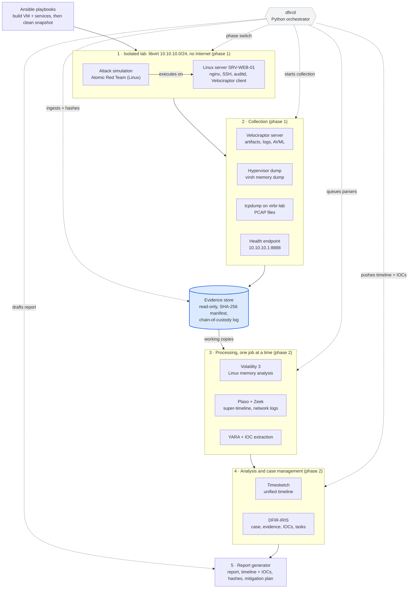

# DFIR Platform: Specification & Architecture&#32;

Oct 13, 2026&#32;

## 1. Overview

The project delivers a self-hosted DFIR platform that runs a **Linux web-server compromise emulation** in an isolated lab, collects the evidence, processes it and produces the incident report. The platform is the tool; the investigation of the simulated incident remains the graded result.

**Objectives**

1. Reproduce a realistic Linux web-server compromise in an isolated, rebuildable lab.
2. Acquire memory, disk artifacts, logs and network traffic with a documented chain of custody.
3. Process evidence automatically into a single timeline, an IOC list and YARA hits.
4. Manage the investigation as a case: evidence, IOCs, tasks, timeline, notes.
5. Generate the deliverables: incident report, timeline + IOCs, evidence hashes, mitigation plan.

**Constraints**

| Item | Value |
| --- | --- |
| Host | Laptop, 16 GB RAM, GTX 1650 (unused by the stack) |
| Host OS | Pop!\_OS (Ubuntu-based) |
| Hypervisor | KVM / libvirt (virt-manager) |
| Duration | 6 weeks, two student |
| Network | Lab fully isolated from the Internet and the host LAN during the incident |
| Budget | Open-source and free evaluation software only |

**Out of scope:** live malware from the wild, cloud deployment, Terraform, multi-user production hardening, GPU acceleration, Windows analysis, cross-platform memory comparison.

## 2. High-level architecture

The platform is structured into five distinct layers arranged in a one-way pipeline, governed by a central Python orchestrator (`dfirctl`). Evidence enters the store once, is immediately hashed for integrity, and remains immutable; all downstream layers operate exclusively on working copies.



**Two-phase operating model.** Layers 1–2 run only during the incident (phase 1, ~6–8 GB RAM). The Linux guest is shut down after acquisition, which frees RAM for layers 3–4 (phase 2, about 10–12 GB). Powering off the victim after acquisition is correct forensic practice, so the hardware limit and the methodology agree.

**Runtime placement.** Only the Linux victim is a VM. Velociraptor, Timesketch and DFIR-IRIS run as Docker Compose stacks on the Pop!\_OS host; Volatility 3, Plaso, Zeek and YARA run as host tools or one-shot containers launched by `dfirctl`. The Pop!_OS host acts as the controlled activity driver and DFIR collection/analysis host.

## 3. Requirements

Twelve functional requirements cover the technical requirements; the non-functional ones come from the hardware and the grading criterion.

**Functional**

| ID | Requirement | Brief requirement covered |
| --- | --- | --- |
| FR-01 | Build the lab (Linux guest, isolated network, services) from Ansible in one command | Preparation |
| FR-02 | Restore the victim to a clean snapshot before each scenario run | Preparation |
| FR-03 | Execute a scripted Linux attack scenario mapped to MITRE ATT&CK | Simulated incident |
| FR-04 | Capture all lab network traffic to PCAP for the whole scenario | Network investigation |
| FR-05 | Acquire memory in-guest (AVML on Linux) and from the hypervisor (virsh dump) | Evidence collection |
| FR-06 | Collect journald, auth.log, auditd, nginx, cron and bash history from Linux via Velociraptor | Evidence collection |
| FR-07 | Hash every evidence item (SHA-256) at acquisition and log custody events | Evidence preservation |
| FR-08 | Run Volatility 3, Plaso, Zeek and YARA on evidence copies, one job at a time | Log, file and malware analysis |
| FR-09 | Merge all sources into one timeline in Timesketch (or CSV fallback) | Timeline construction |
| FR-10 | Extract IOCs (hashes, IPs, domains, paths) and push them to DFIR-IRIS | IOC identification |
| FR-11 | Record findings with their ATT&CK technique and evidence reference | Incident classification |
| FR-12 | Generate the incident report draft (Markdown → PDF) from the case data | Report |
| FR-13 | Document containment, eradication and recovery actions in the report | Mitigation plan |

**Non-functional**

| ID | Requirement |
| --- | --- |
| NFR-01 | Peak RAM stays under 14 GB in either phase; swap or zram as safety net |
| NFR-02 | The lab network has no route to the Internet or the host LAN while the scenario runs |
| NFR-03 | Original evidence is never modified; re-hashing it at report time gives identical values |
| NFR-04 | A full rebuild (provision → scenario → report) is reproducible from the repository |
| NFR-05 | Every command `dfirctl` runs is logged with timestamp, operator and arguments |
| NFR-06 | Evidence and indexes fit in about 250 GB on a dedicated partition or external SSD |

## 4. Component architecture

Fifteen components, one VM; everything else is a container or a host tool. RAM figures are working estimates to validate in week 2.

| Layer | Component | Role | Runtime | RAM (approx.) | Phase |
| --- | --- | --- | --- | --- | --- |
| Lab | Ubuntu Server 24.04 (nginx, OpenSSH, auditd) | Victim: internal web server | KVM VM, 2 vCPU | 2 GB | 1 |
| Lab | Atomic Red Team | Executes ATT&CK techniques | PowerShell Core in victim | in VM | 1 |
| Lab | tcpdump | Full packet capture on the lab bridge | Host process | < 0.1 GB | 1 |
| Lab | lab_health_server.py | Fixed health endpoint for callback simulation | Host process | < 0.1 GB | 1 |
| Collection | Velociraptor server | Remote artifact and memory collection | Docker or single binary | 0.5 GB | 1 + 2 |
| Collection | virsh dump | Hypervisor-level memory acquisition | Host CLI | transient | 1 |
| Collection | AVML | In-guest Linux memory acquisition | Pushed and run by Velociraptor | transient | 1 |
| Processing | Volatility 3 | Linux memory analysis | Host (Python venv) | 1–2 GB | 2 |
| Processing | Plaso (log2timeline, psort) | Super-timeline from artifacts | Docker one-shot | 2–4 GB | 2 |
| Processing | Zeek | PCAP to connection, DNS, HTTP logs | Docker one-shot | < 1 GB | 2 |
| Processing | YARA | Rule scanning of files and memory | Host CLI | < 0.5 GB | 2 |
| Case | Timesketch | Timeline search and tagging | Docker Compose, OpenSearch heap capped at 1.5 GB | ~5 GB | 2 |
| Case | DFIR-IRIS | Case, evidence register, IOCs, tasks | Docker Compose | ~1.5 GB | 1 + 2 |
| Orchestration | dfirctl | Drives phases, ingestion, jobs, reporting | Python 3 on host | < 0.3 GB | 1 + 2 |
| Reporting | Jinja2 + Pandoc | Report draft from case data | Host | < 0.2 GB | 2 |

**Deliberately excluded:** Windows victim, Sysmon, WinPmem, Caldera, Wazuh (indexer alone needs ~4 GB; Velociraptor covers the telemetry), MISP (IRIS holds the IOCs), GPU acceleration (no tool in the stack uses it).

## 5. Lab network and isolation

The single Linux victim sits on a libvirt **isolated** network: it can reach the host's bridge address, nothing else. Host-side nftables rules narrow that further to the few ports the platform needs.

| Element | Value |
| --- | --- |
| libvirt network | `lab-isolated`, mode isolated, no NAT, no DHCP forwarding |
| Subnet | 10.10.10.0/24 |
| Host bridge address | 10.10.10.1 (`virbr-lab`) |
| Linux server | 10.10.10.30, static, hostname `SRV-WEB-01` |
| DNS for the victims | 10.10.10.1 (dnsmasq, logs every query) |
| Capture point | tcpdump on `virbr-lab`, host side, so the victim cannot see or stop it |

**Allowed flows (everything else dropped and logged)**

| From | To | Port | Purpose | When |
| --- | --- | --- | --- | --- |
| Host | Linux server | 22/tcp | Ansible provisioning | Provisioning only; host key removed before the clean snapshot |
| Linux server | Host 10.10.10.1 | 8000/tcp | Velociraptor client → server | Phases 1 and 2 |
| Linux server | Host 10.10.10.1 | 53/udp | DNS (logged) | Phase 1 |
| Linux server | Host 10.10.10.1 | 8888/tcp | Health endpoint callbacks (T1071.001 emulation) | Phase 1 |

Web UIs (Velociraptor GUI, Timesketch, DFIR-IRIS) bind to 127.0.0.1 on the host, never to the lab bridge, so the victim cannot reach the investigation tools. Tool downloads happen on the host and are copied in during provisioning; the victim never gets Internet access.

## 6. Evidence lifecycle and chain of custody

Every item is hashed the moment it lands, stored read-only, and only ever processed from a working copy. A report can then prove each finding traces back to an unmodified original.

1. **Acquire.** Velociraptor, virsh or tcpdump writes to `evidence/incoming/`.
2. **Register.** `dfirctl ingest` computes SHA-256 (and MD5 for tool compatibility), assigns an evidence ID, and writes a custody entry.
3. **Freeze.** The file moves to `evidence/originals/<case>/<evidence-id>/` and is set read-only (`chmod 0444`, `chattr +i`).
4. **Copy.** Processing jobs get a copy in `work/<job-id>/`; the copy's hash is checked against the original before the job starts.
5. **Process.** Outputs go to `results/<evidence-id>/<tool>/` with the tool name, version and command line recorded.
6. **Register in the case.** The evidence item, its hashes and its results are pushed to DFIR-IRIS.
7. **Verify.** `dfirctl verify` re-hashes every original before the report is generated; any mismatch blocks report generation.

**Evidence ID format:** `C01-E###-<type>` (for example `C01-E003-MEM` for the in-guest memory image).

**Custody log** (`custody.jsonl`, append-only, one line per event)

| Field | Example |
| --- | --- |
| timestamp (UTC, ISO 8601) | 2026-11-04T14:22:09Z |
| evidence\_id | C01-E003-MEM |
| action | acquired, registered, copied, processed, verified, exported |
| actor | student account name |
| tool + version | AVML via Velociraptor |
| sha256 | full hash |
| note | free text, for example "victim shut down after acquisition" |

The custody log itself is hashed at the end of each session, and that hash is written into the next session's first entry, so later edits to past entries become detectable.

## 7. Orchestrator design (`dfirctl`)

`dfirctl` is the part of the platform that is your own code: a Python 3 CLI (Typer) that glues the tools together, enforces the evidence rules and runs heavy jobs one at a time so RAM stays within budget.

**Commands**

| Command | What it does |
| --- | --- |
| `dfirctl phase incident` | Stops phase-2 stacks, starts Velociraptor + IRIS, restores the clean snapshot, starts the victim and tcpdump |
| `dfirctl scenario run <name>` | Runs the scenario's ATT&CK steps and logs start/end times of each step as ground truth |
| `dfirctl collect` | Launches Velociraptor collections (triage + AVML), then `virsh dump` of the victim's memory |
| `dfirctl phase analysis` | Stops tcpdump, shuts down the victim, starts Timesketch |
| `dfirctl ingest` | Hashes, registers and freezes everything in `evidence/incoming/` |
| `dfirctl process [--only vol,plaso,zeek,yara]` | Runs the parser queue sequentially on working copies |
| `dfirctl push` | Uploads the Plaso timeline to Timesketch; pushes evidence, IOCs and findings to IRIS via its API |
| `dfirctl verify` | Re-hashes all originals against the manifest |
| `dfirctl report` | Pulls case data from IRIS and renders the report (Jinja2 → Markdown → Pandoc PDF) |

**Modules**

| Module | Responsibility |
| --- | --- |
| `phases.py` | Docker Compose profiles, libvirt power and snapshot control (libvirt-python) |
| `evidence.py` | Hashing, evidence IDs, freeze, custody log |
| `jobs.py` | Sequential job queue, working copies, tool version capture, output paths |
| `parsers/` | One adapter per tool: Volatility 3 plugins, Plaso, Zeek, YARA |
| `iocs.py` | IOC extraction and normalisation from parser outputs (IPs, domains, hashes, paths) |
| `integrations/` | Velociraptor API (gRPC), Timesketch API client, DFIR-IRIS REST API |
| `report.py` | Report templates and rendering |
| `config.py` | One YAML file: paths, case ID, credentials from environment variables |

**Repository layout**

```text
dfir-platform/
├── ansible/            # inventory, roles: host, lab_network, services, server
├── compose/            # velociraptor, iris, timesketch (profiles)
├── libvirt/            # network XML, VM definition
├── dfirctl/            # Python package (modules above)
├── scenarios/          # scenario YAML: ATT&CK steps + expected artifacts
├── rules/              # YARA rules, Sigma notes
├── templates/          # report templates
├── tests/              # pytest: hashing, custody, parsers on sample data
└── docs/               # architecture, runbook, final report
```

Evidence, work copies and results live outside the repository, on the evidence partition, and are never committed.

## 8. Provisioning (Ansible) and snapshots

Ansible builds the environment; `dfirctl` runs the investigation. Nothing forensic lives in playbooks.

| Role | Target | Tasks |
| --- | --- | --- |
| `host` | Pop!\_OS laptop | KVM/libvirt, Docker, Python venv, Volatility 3, YARA, Pandoc, nftables rules, evidence partition mount |
| `lab_network` | Host | Define and start `lab-isolated`, dnsmasq query logging |
| `services` | Host | Deploy Compose stacks with profiles; cap OpenSearch heap; bind UIs to 127.0.0.1 |
| `server` | Ubuntu VM over SSH | Static IP, nginx + small internal app with a SQLite database of dummy records, OpenSSH, auditd rules (execve, cron, SSH config), timestamped bash history, Velociraptor Linux client; plants canary files and synthetic data under `/opt/dfir-demo` |

**Snapshot strategy**

1. Run the `server` role, shut down, snapshot `clean`.
2. Every scenario run starts from `clean`.

Provisioning leaves its own traces on the victim (SSH logons, files under the Ansible user's profile). Because they all predate `clean`, any that appear in the timeline are listed in the report as known benign baseline activity. The playbooks double as the documented baseline of the victim's normal state.

## 9. Incident scenario

**Scenario "Linux web-server compromise emulation":** the Pop!_OS host acts as the controlled activity driver; there is no Windows workstation and no genuine lateral-movement step. This limitation must be stated in the report.

| # | Step | ATT&CK technique | How it is simulated | Expected evidence |
| --- | --- | --- | --- | --- |
| 1 | Inbound web activity marker | T1190 (emulated) | Finite GET to guest nginx from host | nginx access.log, PCAP, auditd execve |
| 2 | Shell execution | T1059.004 | Disposable lab user runs benign diagnostic; writes DFIR-LAB-S02 | auditd execve, bash history, journald |
| 3 | HTTP callback-like traffic | T1071.001 (emulated) | Guest issues GET to http://10.10.10.1:8888/health | PCAP, Zeek http.log, health endpoint log |
| 4 | System discovery | T1082 | Approved Atomic test or harmless uname/hostname | auditd execve, process tree, PCAP |
| 5 | Account discovery | T1033 / T1087.001 | Low-impact test inspecting lab user/account list | auditd execve, auth.log |
| 6 | Synthetic credential-file access | T1552.001 (emulated) | Read canary at /opt/dfir-demo/markers/credential-canary.txt | auditd file access (dfir_demo_data), Velociraptor file collection |
| 7 | Private-key discovery marker | T1552.004 (emulated) | Read planted non-authorized dummy file if required | auditd file access, Velociraptor file collection |
| 8 | Cron persistence behavior | T1053.003 | Temporary cron entry writes timestamp to /tmp/dfir-lab-cron.log | crontab, syslog CRON, auditd execve, bash history |
| 9 | Collection/archive | T1560.001 | Copy /opt/dfir-demo/finance-demo.db to staging dir and archive | auditd, bash history, file metadata |
| 10 | Data staging | T1074.001 | Separate staging dir; record hashes for synthetic archive | auditd, file metadata, hash log |
| 11 | Exfiltration behavior marker | T1041 (emulated only) | Explicit marker logged; health endpoint cannot accept uploads | marker in ground truth, PCAP shows only GET |
| 12 | Defense-evasion marker | T1070.003 (emulated only) | Write marker for attempted history/log clearing; verify prior logs remain | auditd execve, Velociraptor copies survive |

**Ground truth.** `dfirctl scenario run` records the exact start and end time of every step in `case/ground-truth-sealed.jsonl` that is not opened until the analysis is finished. Comparing the reconstructed timeline against it gives a measurable detection result for the report.

**Lab settings to document:** All dummy data is synthetic. No real malware is used. The Pop!_OS host is the controlled activity driver/collector (stated limitation).

## 10. Securing the platform

This is the week 3 "secure" deliverable: the platform holds sensitive evidence and faces a compromised host, so it is hardened like a production investigation environment.

| Threat | Control | How it is verified |
| --- | --- | --- |
| Compromised victim attacks the platform | Isolated network; nftables allow-list (section 5); UIs on 127.0.0.1 only | A port scan from the victim shows only 8000/tcp and 8888/tcp |
| Victim escapes to the Internet or home LAN | libvirt isolated mode, no NAT; nftables drop + log | Ping and curl from the victim to external addresses fail; drops appear in the log |
| Evidence tampering | Read-only originals, `chattr +i`, SHA-256 manifest, chained custody log | `dfirctl verify` passes; a deliberately modified copy is detected |
| Weak or default credentials on tools | Unique generated passwords in an Ansible Vault file; defaults removed | Login with vendor defaults fails on every UI |
| Secrets committed to Git | `.env` and vault files in `.gitignore`; gitleaks pre-commit hook | gitleaks scan of the repository is clean |
| Velociraptor channel sniffed or spoofed | TLS with the server's generated CA pinned in the client config | Client refuses a server with a different certificate |
| Evidence loss | Evidence partition backed up (rsync) after each acquisition | Restore test on one item, hash matches |
| Host itself weakly configured | Lynis audit of the Pop!\_OS host, fix high findings | Lynis score before / after in the report |

## 11. Six-week delivery plan

The plan follows the course's weekly cycle (design, implement, secure, test, improve, deliver). Week 4 is the only week that cannot be redone cheaply, so weeks 1–3 end with a full dry run.

If a gate slips, cut optional scope in this order: DFIR-IRIS, full Ansible/`dfirctl` automation, Timesketch UI (use CSV), then advanced memory analysis. Do not cut isolation proof, evidence hashing/custody, ground truth, timeline, report, or an end-to-end demo.

**Six-week milestones**

- **Week 1 — One-guest lab:** isolated network, Linux guest, auditd/journald/SSH/nginx, synthetic data, Velociraptor client, clean snapshot.
- **Week 2 — Acquisition and custody:** PCAP pilot, Velociraptor triage, optional AVML test, evidence ingest/verify and restore/backup test.
- **Week 3 — Scenario dry run:** twelve safe/emulated steps, ground truth, cleanup, expected artifacts and acceptance checks.
- **Week 4 — Analysis:** Plaso, Zeek, YARA, optional Volatility; export normalized CSV; Timesketch only if memory allows.
- **Week 5 — Findings/report:** IOC register, findings, timeline correlation, mitigation and PDF render.
- **Week 6 — Hardening/demo:** full clean-snapshot run, RAM measurements, Lynis/gitleaks, integrity/custody tamper tests, recorded demo and final submission.

**Mapping to the course deliverables**

| Course deliverable | Produced by the platform as |
| --- | --- |
| Incident report | `dfirctl report` output, edited by hand, with ATT&CK-mapped findings |
| Timeline + IOCs | Timesketch export of tagged events (or Plaso CSV fallback); IOC list exported from DFIR-IRIS |
| Evidence and hashes | Evidence manifest, custody log, `dfirctl verify` output |
| Mitigation plan + presentation | Containment, eradication and recovery section; live demo of the pipeline end to end |
| Technical proof (all projects) | Screenshots, PCAP, Volatility outputs, Lynis before/after, test results from section 12 |

## 12. Testing and acceptance criteria

The project is accepted when every row below passes and the result is shown with a screenshot, log excerpt or command output in the report.

| ID | Test | Pass condition |
| --- | --- | --- |
| AT-01 | Full rebuild from an empty host | `ansible-playbook site.yml` then `dfirctl phase incident` succeed without manual steps |
| AT-02 | Network isolation | Guest cannot reach 1.1.1.1 or the home router; no NAT NIC or forwarding; save XML/route/connection-test proof |
| AT-03 | Memory budget | Peak host RAM below 14 GB in each phase (`free -h` / `vmstat` log) |
| AT-04 | Evidence integrity | `dfirctl verify` passes; flipping one byte in a copy is detected; originals are immutable |
| AT-05 | Custody chain | Editing a *copied* custody entry breaks the session hash chain and is reported |
| AT-06 | Unit tests | `pytest` passes for hashing, evidence IDs, custody log and each parser adapter on sample data |
| AT-07 | Detection coverage | At least 10 of 12 scenario steps have supporting timeline evidence; prefer two sources where available |
| AT-08 | Timing accuracy | Each found step is placed within 2 minutes of the ground-truth time where source precision permits |
| AT-09 | Log-resilience simulation | The non-destructive evasion marker is detected and independently collected logs remain available |
| AT-10 | Memory | If AVML and hypervisor dump are acquired and supported, compare relevant artifacts; otherwise document which acquisition/format/plugin was unavailable |
| AT-11 | Report completeness | Report contains timeline, evidence hashes/custody, IOCs, ATT&CK labels, root cause/impact and mitigation |
| AT-12 | Demo | End-to-end run shown live or from a recorded run; include isolation and integrity proofs |

## 13. Risks and mitigations

The biggest risk is spending the six weeks on infrastructure and too little on the investigation; the gates in section 11 exist to prevent that.

| Risk | Likelihood | Impact | Mitigation |
| --- | --- | --- | --- |
| Infrastructure eats the schedule | High | High | Week 2 gate; drop DFIR-IRIS, then full Ansible/dfirctl automation, then Timesketch UI, then advanced memory analysis; investigation scope stays fixed |
| Timesketch / OpenSearch runs out of memory | Medium | Medium | Heap capped at 1.5 GB; victim off in phase 2; fallback: Plaso CSV output reviewed in spreadsheet/timeline viewer |
| Disk fills during processing | Medium | High | ~250 GB on a dedicated partition; delete work copies after each job; `df` check in `dfirctl` before each job |
| Volatility 3 cannot read the virsh dump format | Medium | Low | Test in week 2 with a small dump; AVML image remains the primary memory source |
| Scenario step fails silently (typo, timing) | Medium | Medium | Dry run in week 3; ground-truth file records each step's exit status |
| Laptop failure or data loss | Low | High | Repository on GitHub; evidence backed up after week 4; the lab rebuilds from code |
| Tool version changes break parsers | Low | Medium | Pin Docker image tags and Python package versions; record versions in the custody log |
| Volatility 3 has no symbol table for the server's kernel | High | Medium | Build the ISF file with dwarf2json from the server's debug kernel in week 2; pin the kernel version (no updates) until the scenario is done |
